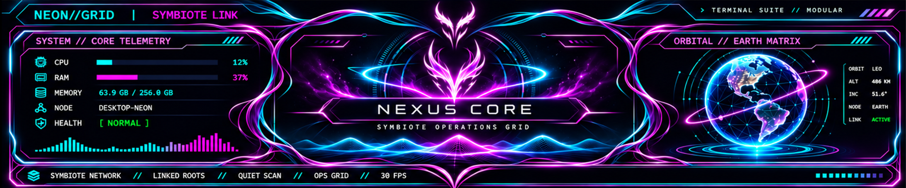
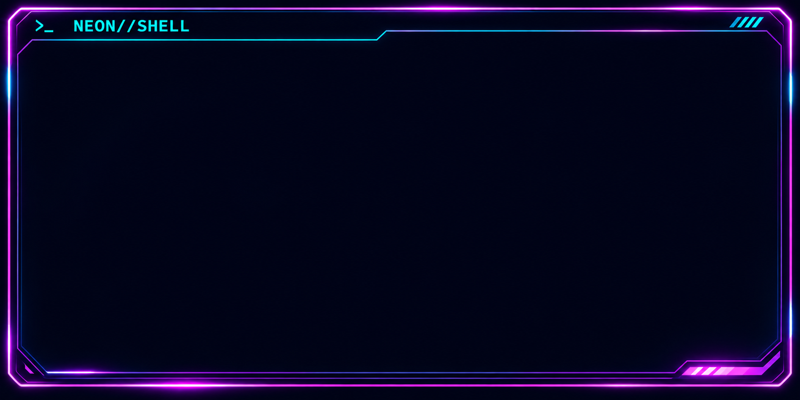
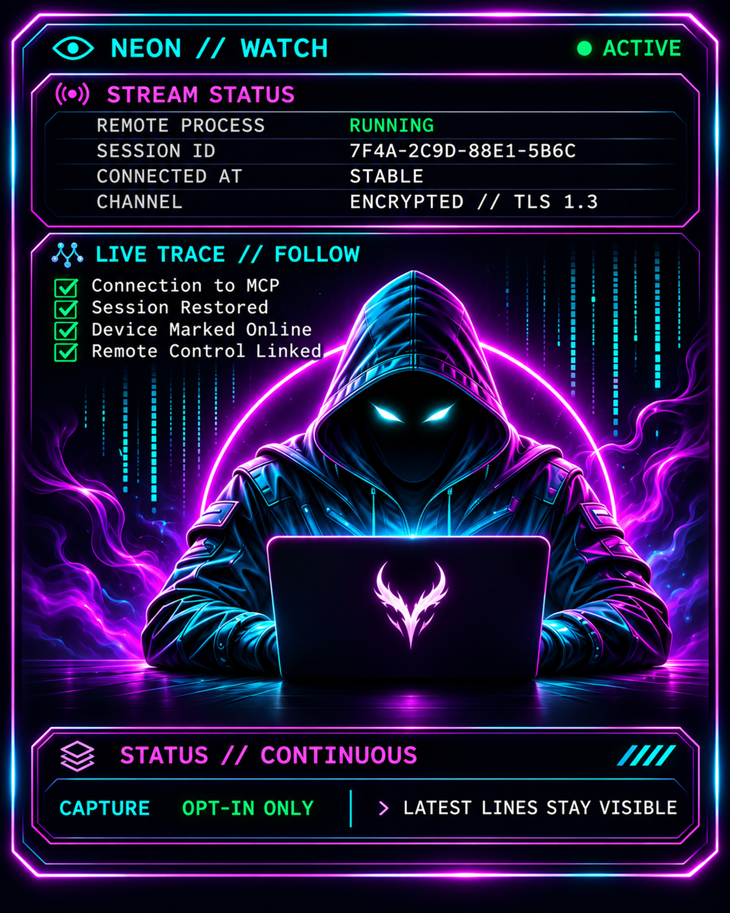

# NEON//GRID · Symbiote Terminal

A vivid, **three-pane cyberpunk theme for Windows Terminal**, with 4K neon artwork, a real interactive PowerShell command area, and an optional [Desktop Commander Remote](https://desktopcommander.app/) launcher. The decorative status panels are intentionally static, so the design stays smooth and doesn't compete with your commands.



### Install in one command

Open **Windows PowerShell** and run:

```powershell
irm https://raw.githubusercontent.com/Tanveer-Devlpr/neon-grid-terminal/main/install.ps1 | iex
```

The installer downloads the open-source package, backs up your existing Windows Terminal settings, adds NEON//GRID profiles and color schemes, and sets the new shell as default. If Windows Terminal is missing, it attempts to install it via `winget`. It never adds a global PowerShell profile or takes over your existing Desktop Commander session.

**Supported:** Windows 10/11, PowerShell 5.1+, Windows Terminal, and an internet connection for the one-command installer. You do **not** need administrator privileges when Windows Terminal and its dependencies are already installed. Some Windows/enterprise policies or `winget` installations may require confirmation or prevent automatic setup.

### Layout

| Area | Behavior |
| --- | --- |
| Upper telemetry / Nexus Core / globe | Static, high-resolution artwork |
| Lower-left NEON//SHELL | **Actual PowerShell terminal**, interactive and scrollable |
| Lower-right hacker / watch | Static, high-resolution artwork |
| Optional remote layout | Runs Desktop Commander Remote, or reuses an existing connection |





### Open / control

- Open a new Windows Terminal tab. **NEON GRID // SHELL** is the default.
- Select **NEON GRID // REMOTE** from the Terminal profiles menu for the remote layout.
- **Ctrl+Alt+R** opens the remote tab when that shortcut isn't already assigned to something else.
- Type `neon-remote` in a NEON terminal to open the remote layout.
- Type `neon-remote-status` to check for Desktop Commander processes.
- To customize the command-pane breathing room, change its `padding` values in Terminal Settings. The default is **75, 95, 70, 80** (left, top, right, bottom).

Desktop Commander is **optional**. For remote capability, install [Node.js](https://nodejs.org/) and complete Desktop Commander's own sign-in / permissions setup. The installer does not bundle credentials and never grants remote control by itself.

### Images and accuracy

The package ships three final assets:

- `assets/hud.png` — 3840 × 801 upper dashboard.
- `assets/shell.png` — 3840 × 1920 console frame.
- `assets/watch.png` — 3072 × 3839 watch artwork.

The images are upscaled originals. Upscaling increases pixel dimensions, not native fine detail.

**Important:** CPU, RAM, node, orbit, session status, and connection labels drawn *inside the artwork* are fictional/decorative, not real measurements or a guarantee that a remote session is connected. The command output is real.

### Updates and removal

Re-run the same one-line installer to update. Existing Windows Terminal settings are backed up again before an update; unrelated profiles are preserved. An assigned Ctrl+Alt+R shortcut belonging to another app/profile is never overwritten.

To remove the NEON//GRID Terminal profiles and restore your previous default:

```powershell
& "$env:LOCALAPPDATA\Programs\NeonGridTerminal\scripts\Uninstall.ps1"
```

The uninstaller intentionally leaves the package files and backups on disk for recovery. You can delete `%LOCALAPPDATA%\Programs\NeonGridTerminal` once your old NEON tabs are closed.

### Safety and privacy

- Source code and exact artwork are public and inspectable before running the installer.
- The PowerShell one-liner executes code fetched over HTTPS. Review [install.ps1](install.ps1) first if you prefer.
- The installer writes only to its user-local package folder and the current user's Windows Terminal settings. It creates timestamped backups.
- It does **not** upload logs, scan user files, ask for passwords, or bundle local access tokens.
- Existing Windows Terminal profiles are not removed.

### Development

All installer/runtime scripts target **Windows PowerShell 5.1+**. The repo includes smoke tests designed to run with isolated settings rather than overwriting a developer's live configuration.

### License

MIT, including redistributed original AI-generated theme artwork to the extent applicable rights are held by the project author. See [LICENSE](LICENSE).
